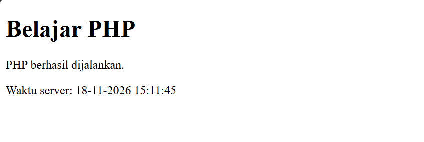
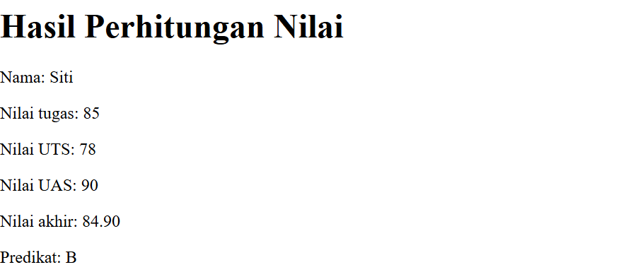
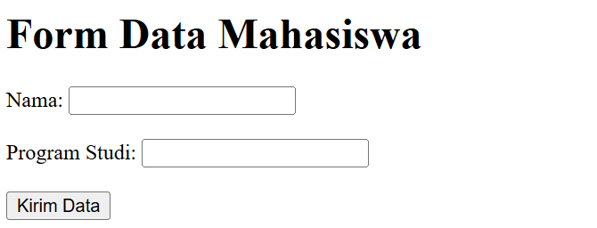
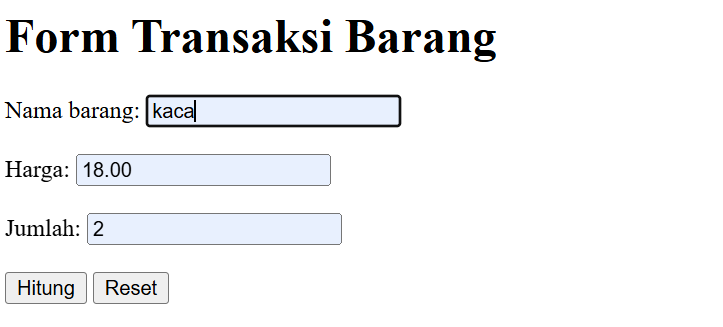

# Lab7Web_PHP — Praktikum 7 Pemrograman Server-Side dengan PHP

## Identitas
- Mata Kuliah: Pemrograman Web
- Praktikum: 7
- Topik: Pemrograman Server-Side dengan PHP
- Nama: Meylla Intan Kurnia
- NIM: (isi sesuai NIM yang digunakan)
- Kelas: (isi kelas)

## Tujuan Praktikum
1. Memahami perbedaan pemrosesan client-side dan server-side.
2. Mengenali sintaks PHP dan menjalankan file PHP melalui server lokal.
3. Menggunakan variabel, tipe data, operator, percabangan, perulangan, array, dan function.
4. Memproses data form menggunakan metode GET dan POST.
5. Melakukan validasi dan sanitasi input.
6. Membuat aplikasi sederhana untuk menerima dan menampilkan data pengguna.

## Perangkat
- Laptop/PC
- Visual Studio Code
- PHP
- XAMPP atau Laragon
- Web browser

## Struktur Folder
```text
Lab7Web_PHP/
├── latihan1/
│   └── index.php
├── latihan2/
│   └── index.php
├── latihan3/
│   └── index.php
├── latihan4/
│   └── index.php
├── latihan5/
│   └── cari.php
├── latihan6/
│   └── index.php
├── latihan7/
│   └── index.php
├── miniproject/
│   └── index.php
└── README.md
```

## Cara Menjalankan
1. Instal dan buka XAMPP.
2. Jalankan Apache pada XAMPP.
3. Salin folder `Lab7Web_PHP` ke dalam folder `htdocs`.
4. Buka browser dan akses alamat berikut:
   - `http://localhost/Lab7Web_PHP/latihan1/`
   - `http://localhost/Lab7Web_PHP/latihan2/`
   - `http://localhost/Lab7Web_PHP/latihan3/`
   - `http://localhost/Lab7Web_PHP/latihan4/`
   - `http://localhost/Lab7Web_PHP/latihan5/cari.php`
   - `http://localhost/Lab7Web_PHP/latihan6/`
   - `http://localhost/Lab7Web_PHP/latihan7/`
   - `http://localhost/Lab7Web_PHP/miniproject/`
5. Pastikan file dibuka melalui `localhost`, bukan dengan klik dua kali pada file PHP.

## Ringkasan Hasil Praktikum
- **Latihan 1:** Menampilkan teks bahwa PHP berhasil dijalankan dan waktu server.
- 
- **Latihan 2:** Menghitung nilai akhir dari tugas, UTS, dan UAS, kemudian menentukan predikat.
- 
- **Latihan 3:** Menampilkan daftar nama mahasiswa menggunakan array dan `foreach`.
- 
- **Latihan 4:** Menggunakan function untuk menghitung harga setelah diskon dan luas persegi panjang.
- 
- **Latihan 5:** Mengirim kata kunci menggunakan metode GET dan menampilkannya kembali.
- 
- **Latihan 6:** Menerima nama dan program studi menggunakan metode POST.
- 
- 
- **Latihan 7:** Menghitung subtotal transaksi dari nama barang, harga, dan jumlah.
- 
- 

## Pengujian Input
### Contoh input valid
1. Form data mahasiswa diisi dengan nama, NIM, dan program studi yang tidak kosong.
2. Mini project diisi dengan semester `3` dan email `mahasiswa@example.com`.

### Contoh input tidak valid
1. Nama atau program studi dikosongkan pada latihan 6.
2. Semester mini project diisi `0`, `15`, atau bukan bilangan bulat.
3. Email mini project ditulis tanpa format email yang benar.
4. Jumlah barang pada latihan 7 diisi `0` atau angka negatif.

## Kesimpulan
Praktikum 7 membantu memahami dasar pemrograman server-side menggunakan PHP. Melalui latihan yang dilakukan, PHP dapat digunakan untuk mengolah variabel, melakukan perhitungan, menjalankan percabangan dan perulangan, membuat function, serta menerima data dari form dengan GET dan POST. Validasi server-side dan `htmlspecialchars()` juga diperlukan agar data yang diterima dan ditampilkan dapat diperiksa serta ditangani dengan lebih aman.
